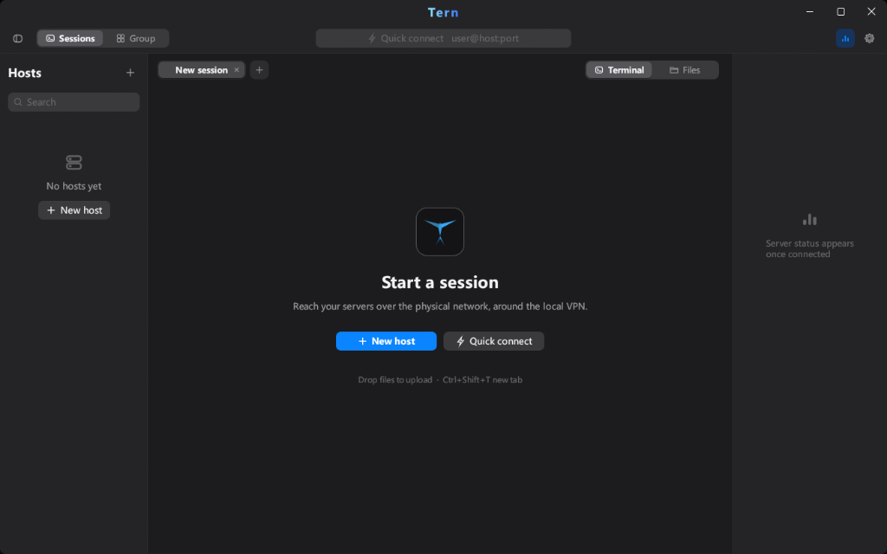
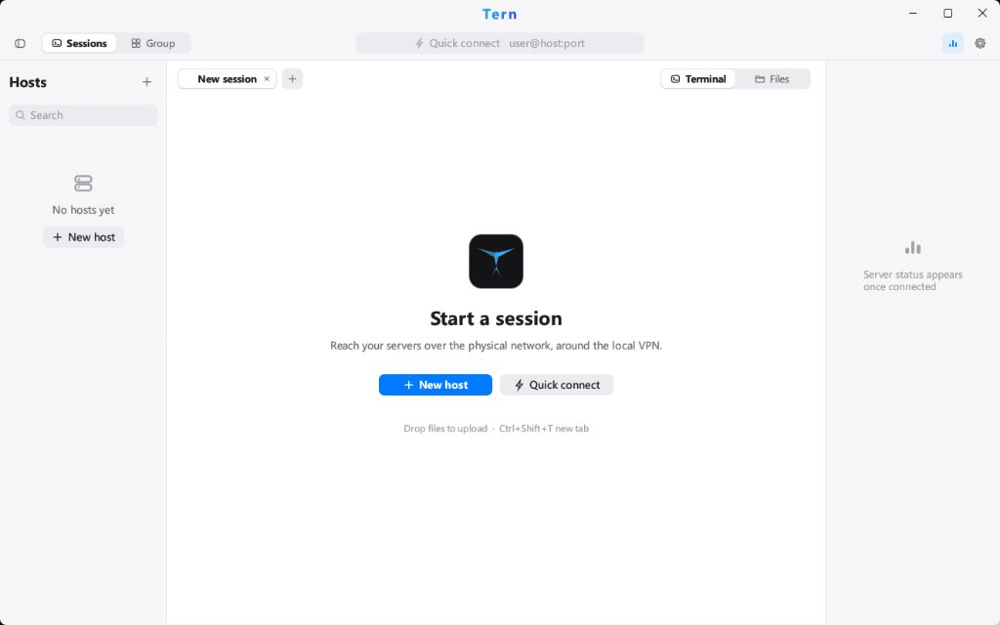
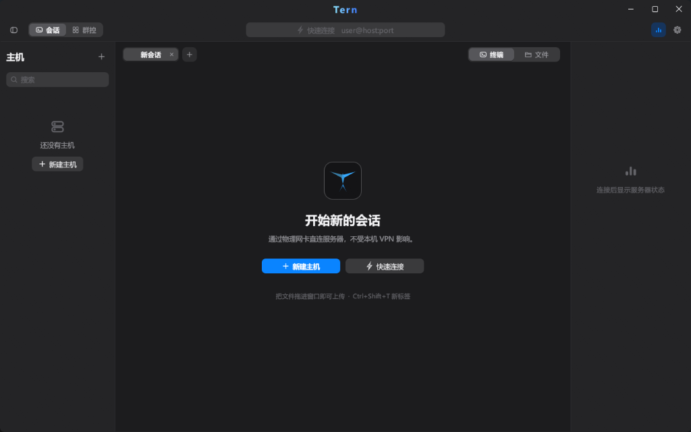

<p align="center"></p>

<h1 align="center">Tern</h1>

<p align="center">
  A sleek Rust SSH &amp; SFTP client with multi-host group control that binds outbound TCP to a physical non-TUN interface to bypass local VPNs.
</p>

<p align="center">
  <a href="https://github.com/Y1chenovo/Tern/actions/workflows/ci.yml"></a>
  <a href="https://github.com/Y1chenovo/Tern/releases"></a>
  <a href="LICENSE"></a>
</p>

<p align="center">
  <b>English</b> · <a href="README.zh-CN.md">简体中文</a>
</p>

<p align="center">
  
</p>

| Light Theme | Built-in Chinese UI (简体中文) |
| :---: | :---: |
|  |  |

---

## Why Tern?

When a TUN/VPN client (`tun0`, `wg0`, `utun`, `Wintun`) becomes the system default route, normal `ssh user@vps` traffic gets routed through the tunnel — causing routing loops when connecting to the VPN host itself, double encryption, or unwanted egress paths.

**Tern** binds its outbound `TcpSocket` directly to your physical adapter (and `SO_BINDTODEVICE` on Linux) *before* calling `connect()`, pairing a low-level VPN bypass engine with a 60fps desktop GUI (`egui`), SFTP browser, and multi-host group controller.

---

## Highlights

- **Physical NIC VPN Bypass**
  - Automatic physical adapter selection based on route metrics and hardware interface flags.
  - Explicit `--bind-addr` (local IPv4) or `--bind-iface` (`SO_BINDTODEVICE` on Linux, automatic fallback to source-IP binding without `CAP_NET_RAW`).
  - Optional custom DNS resolver (`1.1.1.1`, etc.) routed over the bound physical interface, plus local port forwarding (`ssh -L`).
- **Multi-Host Group Control (`Ctrl+Shift+G`)**
  - Side-by-side live terminal grid for all online hosts with adaptive columns.
  - Command broadcast bar (with interrupt button) and real-time synchronized keyboard input mirroring (`vim`, interactive prompts).
  - Cluster overview panel (load, CPU, memory) and 4-host bounded-concurrency batch SFTP upload/download.
- **High-Throughput SFTP & Built-in Editor**
  - Pipelined 4 MiB transfer window with drag-and-drop recursive folder upload and recursive folder download.
  - Concurrent directory pre-scan progress, sleep prevention during transfers, and automatic partial/empty-dir cleanup on cancellation.
  - Atomic remote saves (`posix-rename@openssh.com` / snapshot copy) with `(size, mtime)` conflict detection before committing.
  - Syntax highlighting (`JSON`, `YAML`, `TOML/INI`, `Shell`, `Nginx`), `Ctrl+F` / `Ctrl+H` find & replace, remote `chmod` modal, symlink target tooltips, and Terminal ↔ SFTP directory sync (`OSC 7` + one-click `cd`).
- **Native Terminal & Productivity**
  - Full `vt100` emulation (TrueColor, alternate screen for `vim`/`htop`/`tmux`, mouse reporting, IME positioning, 1k–50k scrollback).
  - `Ctrl + Click` to open `http://` / `https://` URLs detected in terminal output.
  - Persistent **Command Snippets** library, one-click `~/.ssh/config` import (including `Include` globs and deduplication), and cancellable exponential-backoff auto-reconnect (`2s → 30s`).
- **Security-First Design**
  - Passwords and private-key passphrases stored strictly in native OS keychains (Windows Credential Manager, macOS Keychain, Linux Secret Service) via an ordered background queue — zero plaintext fallback on write errors.
  - Strict per-algorithm host-key verification (`known_hosts.json`) checked before credentials are sent; fails closed if the store is corrupted.
  - Path traversal, symlink-loop, and Windows reserved-device-name sanitization on all transfers.

---

## Installation

### Prebuilt Binaries

Download archives for **Windows (`x86_64`)**, **Linux (`x86_64`)**, and **macOS (`arm64` / `x86_64`)** from [**GitHub Releases**](https://github.com/Y1chenovo/Tern/releases):

- `tern` / `tern.exe` — Desktop GUI (launches GUI by default, also supports CLI flags).
- `tern-cli` / `tern-cli.exe` — Lightweight headless CLI build (`--no-default-features`).

> **Windows note**: `tern.exe` is a standalone portable executable; double-click to launch the GUI or invoke it from a terminal for CLI mode.

### Build from Source

Requires **Rust 1.89+** (`ring` crypto backend requires no NASM). On Linux, install X11/Wayland and D-Bus development libraries first:

```bash
# Ubuntu / Debian GUI dependencies
sudo apt-get install -y pkg-config libdbus-1-dev \
  libxcb-render0-dev libxcb-shape0-dev libxcb-xfixes0-dev \
  libxkbcommon-dev libwayland-dev libgl1-mesa-dev

git clone https://github.com/Y1chenovo/Tern.git
cd Tern

# GUI + CLI (default)
cargo build --release

# Headless CLI only
cargo build --release --no-default-features
```

---

## CLI Usage

```bash
# Launch GUI (or pass a prefilled host)
tern --gui
tern --gui user@vps.example.com

# Inspect adapters and see what Auto mode chooses
tern --list-interfaces

# Auto-bypass VPN and open an interactive shell
tern user@vps.example.com

# Linux: hard-bind to eth0 using SO_BINDTODEVICE
tern -i ~/.ssh/id_ed25519 -p 22 --bind-iface eth0 user@vps

# Bind explicitly to a local LAN IP (Linux / Windows / macOS)
tern --bind-addr 192.168.1.10 --no-password user@vps
```

| Flag / Env | Description |
|---|---|
| `destination` | `[user@]host` (omit to launch GUI) |
| `--gui` | Force-launch the `egui` desktop interface |
| `-p, --port <PORT>` | SSH port (default: `22`) |
| `-l, --user <USER>` | Username (overrides `user@host`) |
| `-i, --identity <FILE>` | OpenSSH private key path |
| `--bind-addr <IP>` | Bind outbound socket to a local IPv4/IPv6 address |
| `--bind-iface <IFACE>` | Bind to interface via `SO_BINDTODEVICE` (Linux only) |
| `--list-interfaces` | List local IPv4 adapters and automatic selection |
| `--no-password` | Key-only authentication; disable password prompts |
| `--accept-new-hostkey` | Automatically trust unseen host keys (changed keys are still rejected) |
| `TERN_PASSWORD` | Environment variable for non-interactive scripting password |

---

## Keyboard Shortcuts

| Shortcut | Action |
|---|---|
| `Ctrl+Shift+T` / `Ctrl+Shift+W` | New / close session tab |
| `Ctrl+Tab` / `Ctrl+Shift+Tab` | Next / previous tab |
| `Ctrl+Shift+N` | New host |
| `Ctrl+Shift+G` | Toggle single session / group control mode |
| `Ctrl+Shift+F` | Find in terminal output |
| `Ctrl+Shift+C` / `Ctrl+Shift+V` | Copy / paste in terminal |
| `Ctrl+Shift+=` / `Ctrl+Shift+-` / `Ctrl+Wheel` | Adjust terminal font size |
| `Ctrl + Click` | Open `http://` or `https://` URL under cursor in browser |
| `Shift + Drag` | Select text inside mouse-tracking TUI apps (`htop`, `vim`) |
| `Ctrl+S` / `Ctrl+F` / `Ctrl+H` | Built-in editor: save / find / replace |

---

## How VPN Bypass Works & Platform Support

| Platform | Support | Mechanism & Notes |
|---|---|---|
| **Linux** | Full | Prefers `SO_BINDTODEVICE` on the physical default-route NIC (lowest metric), falling back to source-IP `bind()` if unprivileged. Grant once with `sudo setcap cap_net_raw+ep ./tern`. |
| **Windows** | Best-effort | Enumerates hardware adapters & route metrics, skips virtual/TUN NICs (including Wintun adapters), and binds outbound TCP to the physical IPv4 address. Verify actual egress under complex policy routing. |
| **macOS** | Partial | Excludes `utun` interfaces and binds to a non-tunnel local IP; VPN bypass effectiveness varies by macOS VPN client routing rules. |

Loopback targets (`127.0.0.1`, `::1`) skip interface binding automatically. Detailed routing policies on some commercial VPNs can still capture traffic when only source-IP binding is available — inspect the GUI **Connection Path** readout to verify the actual bound local socket.

---

## Architecture

- [`src/bypass.rs`](src/bypass.rs) — Cross-platform NIC discovery, route-metric selection, custom DNS over bound IP, and socket binding.
- [`src/session.rs`](src/session.rs) — Async `russh` + `russh-sftp` engine, PTY lifecycle, port forwarding (`16 MiB` per-tunnel cap), remote metrics, and atomic/snapshot SFTP transfers.
- [`src/profiles.rs`](src/profiles.rs) — Atomic config persistence (`%APPDATA%\Tern` / `~/.config/tern`), `~/.ssh/config` parser, and OS keychain integration.
- [`src/hostkeys.rs`](src/hostkeys.rs) — Per-algorithm case-insensitive `known_hosts.json` verifier.
- [`src/gui/`](src/gui/) — `egui` workspace (`mod.rs`, `term.rs`, `conn.rs`, `hosts.rs`, `files.rs`, `highlight.rs`, `snippets.rs`, `batch.rs`, `group.rs`, `panels.rs`, `picker.rs`, `theme.rs`, `widgets.rs`, `credentials.rs`, `chrome.rs`).

---

## Changelog & License

- See [CHANGELOG.md](CHANGELOG.md) for release notes.
- Licensed under the [MIT License](LICENSE).
