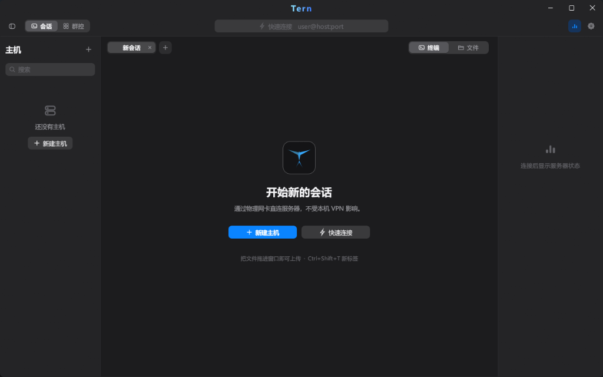
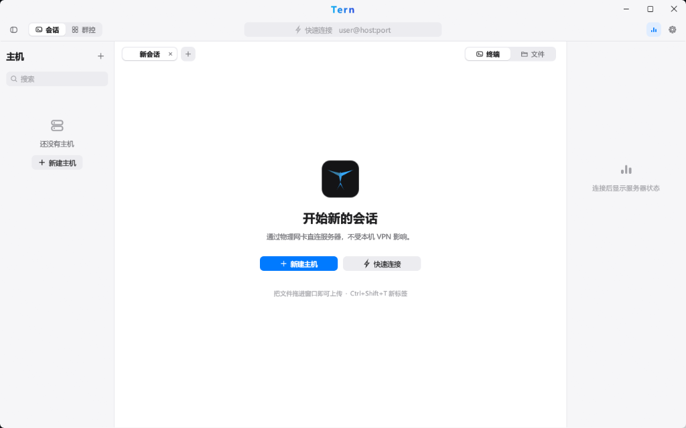
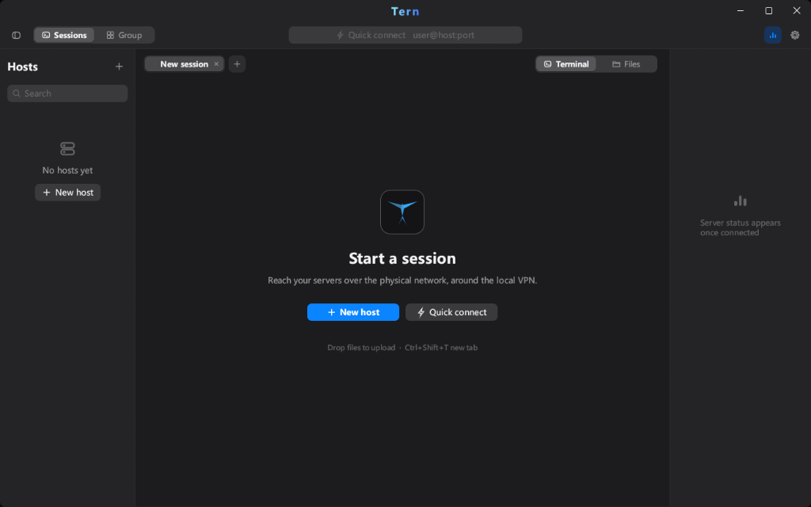

<p align="center"></p>

<h1 align="center">Tern</h1>

<p align="center">
  简洁、顺滑的 Rust SSH / SFTP 客户端：将出站 TCP 绑定到物理网卡绕开本机 VPN 直连服务器，内置多机群控与批量文件分发。
</p>

<p align="center">
  <a href="https://github.com/Y1chenovo/Tern/actions/workflows/ci.yml"></a>
  <a href="https://github.com/Y1chenovo/Tern/releases"></a>
  <a href="LICENSE"></a>
</p>

<p align="center">
  <a href="README.md">English</a> · <b>简体中文</b>
</p>

<p align="center">
  
</p>

| 浅色主题（Light Theme） | 内置英文界面（English UI） |
| :---: | :---: |
|  |  |

---

## 为什么选择 Tern？

当本机开启 TUN/VPN（`tun0`、`wg0`、`utun`、`Wintun` 等）接管默认路由后，普通的 `ssh user@vps` 流量会被吸进隧道——在连接 VPN 宿主机本身时会发生回环或断连，并带来双重加密与出口错乱问题。

**Tern** 会在底层 `connect()` **之前**将出站 `TcpSocket` 绑定到物理网卡地址（Linux 优先使用 `SO_BINDTODEVICE`），同时提供 60fps 自绘桌面界面（`egui`）、高吞吐 SFTP 文件管理与多机群控功能。

---

## 核心亮点

- **物理网卡 VPN 旁路直连**
  - 自动探测物理网卡（按默认路由跃点数与硬件接口标志排除虚拟/TUN 适配器）。
  - 支持 `--bind-addr`（绑定本地物理 IPv4/IPv6）与 Linux 专属 `--bind-iface`（`SO_BINDTODEVICE`，无权限时自动回退至源 IP 绑定）。
  - 支持通过选定物理网卡直连自定义 DNS（如 `1.1.1.1`），并集成标准本地端口转发（`ssh -L`）。
- **多机群控（`Ctrl+Shift+G`）**
  - 自适应网格同屏展示多台在线主机终端，支持底部指令广播、一键中断全部与实时键盘同步镜像（兼容 `vim` 与交互确认）。
  - 右侧「集群概览」实时汇总各节点负载、CPU 与内存；「群发文件」支持 4 台并发受控的目录树批量上传与按主机分目录拉取。
- **高吞吐 SFTP 与内置编辑器**
  - `4 MiB` 并发窗口传输，支持拖拽上传文件夹与**完整目录树递归下载**。
  - 4 路并发目录预扫描与实时文件计数、传输期间自动防系统休眠、取消自动清理半截文件与新建空目录。
  - 同目录临时文件原子写入（或已传快照原地更新），提交前校验远端 `(size, mtime)` 防止并发误覆盖。
  - 内置文本编辑器支持语法高亮（`JSON`、`YAML`、`TOML/INI`、`Shell`、`Nginx`）与 `Ctrl+F` / `Ctrl+H` 查找替换；支持远端 `chmod` 权限弹窗、软链接目标悬停提示与终端 ↔ 文件目录联动（`OSC 7` + 一键 `cd`）。
- **原生终端体验与高频工作流**
  - 完整 `vt100` 仿真（真彩色、`vim`/`htop`/`tmux` 备用屏幕、鼠标上报、中文输入法跟随光标、1k–50k 可调回滚）。
  - 终端内 `Ctrl + 点击`（或右键）安全唤起浏览器打开 `http://` / `https://` 链接。
  - 持久化**命令片段库（Snippets）**、一键导入 `~/.ssh/config`（支持 `Include` 通配与自动去重）、指数退避断线自动重连（`2s → 30s`）。
- **安全优先架构**
  - 密码与私钥口令仅存入操作系统原生凭据库（Windows 凭据管理器 / macOS Keychain / Linux Secret Service），后台顺序队列写入且失败绝不降级存明文。
  - 严格按主机名（不区分大小写）+ 端口 + 密钥算法保存 `known_hosts.json`，在发送凭据前校验证书，文件损坏时默认阻断（fail-closed）。
  - 全链路拦截 `..` 路径穿越、目录符号链接环路与 Windows 保留设备名。

---

## 下载与安装

### 直接下载预编译包（推荐）

前往 [**GitHub Releases**](https://github.com/Y1chenovo/Tern/releases) 下载对应平台压缩包（支持 **Windows `x86_64`**、**Linux `x86_64`**、**macOS `arm64` / `x86_64`**）：

- `tern` / `tern.exe` — 桌面图形版（默认进 GUI，同时也支持全部 CLI 参数）。
- `tern-cli` / `tern-cli.exe` — 轻量无图形依赖的纯命令行版（`--no-default-features`）。

> **Windows 提示**：`tern.exe` 为绿色单文件，直接双击即可打开桌面界面；在终端传参即可作为 CLI 使用。

### 从源码构建

需要 **Rust 1.89+**（底层使用纯 Rust/`ring` 加密，无需安装 NASM）。Linux 构建 GUI 需先安装图形与 D-Bus 开发库：

```bash
# Ubuntu / Debian 依赖
sudo apt-get install -y pkg-config libdbus-1-dev \
  libxcb-render0-dev libxcb-shape0-dev libxcb-xfixes0-dev \
  libxkbcommon-dev libwayland-dev libgl1-mesa-dev

git clone https://github.com/Y1chenovo/Tern.git
cd Tern

# 构建完整版（GUI + CLI，默认）
cargo build --release

# 仅构建纯命令行版（无图形库依赖）
cargo build --release --no-default-features
```

---

## 命令行（CLI）用法

```bash
# 启动图形界面（可省略参数直接启动，或预填连接主机）
tern --gui
tern --gui user@vps.example.com

# 查看本机 IPv4 网卡及 Auto 模式探测结果
tern --list-interfaces

# 自动绕过 VPN 连接服务器
tern user@vps.example.com

# Linux：使用 SO_BINDTODEVICE 硬绑定 eth0 接口
tern -i ~/.ssh/id_ed25519 -p 22 --bind-iface eth0 user@vps

# 显式绑定物理局域网 IP（全平台通用）并禁用密码提示
tern --bind-addr 192.168.1.10 --no-password user@vps
```

| 参数 / 环境变量 | 说明 |
|---|---|
| `destination` | `[user@]host`（不传时默认打开 GUI） |
| `--gui` | 强制启动 `egui` 桌面界面 |
| `-p, --port <PORT>` | SSH 端口（默认 `22`） |
| `-l, --user <USER>` | 用户名（覆盖 `user@host`） |
| `-i, --identity <FILE>` | OpenSSH 私钥路径 |
| `--bind-addr <IP>` | 出站绑定到本地 IPv4/IPv6 地址 |
| `--bind-iface <IFACE>` | 通过 `SO_BINDTODEVICE` 绑定物理网卡（仅 Linux） |
| `--list-interfaces` | 列出本地 IPv4 适配器及自动绑定选择 |
| `--no-password` | 仅私钥认证，禁用密码交互 |
| `--accept-new-hostkey` | 首次连接自动信任主机密钥（密钥变化仍会拒绝） |
| `TERN_PASSWORD` | 脚本环境非交互传入密码（避免密码暴露在进程参数里） |

---

## 快捷键速查

| 快捷键 | 功能 |
|---|---|
| `Ctrl+Shift+T` / `Ctrl+Shift+W` | 新建 / 关闭会话标签 |
| `Ctrl+Tab` / `Ctrl+Shift+Tab` | 切换标签页 |
| `Ctrl+Shift+N` | 新建主机配置 |
| `Ctrl+Shift+G` | 切换「单会话 / 多机群控」视图 |
| `Ctrl+Shift+F` | 在终端输出中查找 |
| `Ctrl+Shift+C` / `Ctrl+Shift+V` | 终端复制 / 粘贴 |
| `Ctrl+Shift+=` / `Ctrl+Shift+-` / `Ctrl+滚轮` | 调整终端字体大小 |
| `Ctrl + 点击` | 在系统浏览器中打开终端里的 HTTP(S) 链接 |
| `Shift + 拖动` | 在接管鼠标的 TUI 程序（如 `htop`、`vim`）中强行划词 |
| `Ctrl+S` / `Ctrl+F` / `Ctrl+H` | 内置编辑器：保存 / 查找 / 替换 |

---

## 绕过原理与平台支持矩阵

| 平台 | 支持程度 | 实现方式与说明 |
|---|---|---|
| **Linux** | 完整支持 | 优先对最低跃点物理网卡调用 `SO_BINDTODEVICE`，无权限时自动回退至源地址 `bind()`。可一次性授权：`sudo setcap cap_net_raw+ep ./tern`。 |
| **Windows** | 尽力而为 | 结合硬件适配器标志与默认路由跃点数，自动排除虚拟/TUN 适配器（含 Wintun）并绑定物理 IPv4；复杂策略路由下建议对照界面「连接路径」核实出口。 |
| **macOS** | 部分支持 | 自动排除 `utun` 等虚拟接口并绑定物理 IP；具体旁路效果取决于对应 VPN 客户端的系统路由策略。 |

连接 `127.0.0.1` / `::1` 等回环地址时自动跳过绑定。若在只支持源地址绑定的平台上仍被 VPN 全局规则劫持，可在右侧监控面板查看「本地出口（local socket）」确认实际使用的源地址。

---

## 架构概览

- [`src/bypass.rs`](src/bypass.rs) — 跨平台物理网卡枚举、路由跃点择优、物理口自定义 DNS 查询与套接字绑定。
- [`src/session.rs`](src/session.rs) — 基于 `russh` + `russh-sftp` 的异步会话、PTY、端口转发（单连接 `16 MiB` 背压上限）、主机状态采样及原子/断点保护传输引擎。
- [`src/profiles.rs`](src/profiles.rs) — 原子配置持久化（`%APPDATA%\Tern` / `~/.config/tern`）、`~/.ssh/config` 解析导入与系统凭据库桥接。
- [`src/hostkeys.rs`](src/hostkeys.rs) — 按主机名（大小写归一）+ 端口 + 算法存储与校验的 `known_hosts.json`。
- [`src/gui/`](src/gui/) — `egui` 桌面模块（`mod.rs`、`term.rs`、`conn.rs`、`hosts.rs`、`files.rs`、`highlight.rs`、`snippets.rs`、`batch.rs`、`group.rs`、`panels.rs`、`picker.rs`、`theme.rs`、`widgets.rs`、`credentials.rs`、`chrome.rs`）。

---

## 更新记录与开源协议

- 详细版本变更见 [CHANGELOG.md](CHANGELOG.md)。
- 基于 [MIT License](LICENSE) 开源。
